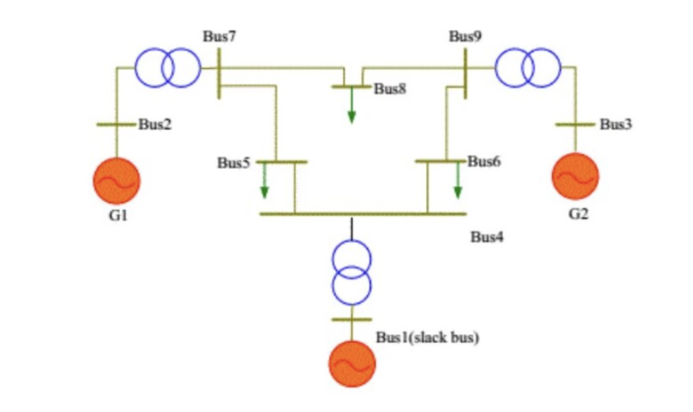

# Can perform three-machine nine-node power flow calculation, NREL power flow calculation, and can also modify input parameters (Matlab code)

Three-machine nine-node power flow calculation, P-V method power flow calculation, and can also modify input parameters (Matlab code)
It can perform three-machine nine-node power flow calculations, the NR method for power flow calculation, and also allows you to modify input parameters on your own.
\n        \n  
\n        \n  

## Images

<!-- PAYMENT_BLOCK -->

## Get this dataset

- Payment link (Stripe): [Buy now](https://buy.stripe.com/3cs8yP7sY87d0vu9AB)
- Payment QR code: 

<!-- /PAYMENT_BLOCK -->
